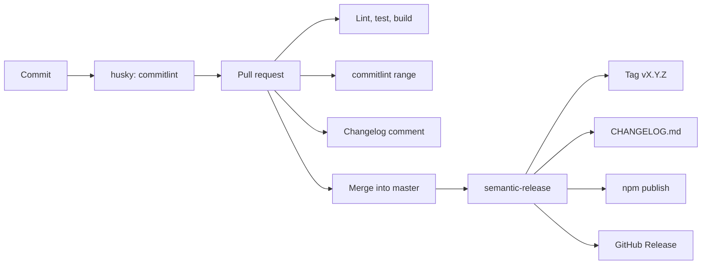

# Commits, changelog, and release

The package version is not edited by hand. [semantic-release](https://github.com/semantic-release/semantic-release) calculates it from commit messages:

- message format: [Conventional Commits 1.0.0](https://www.conventionalcommits.org/en/v1.0.0/);
- version number: [SemVer 2.0.0](https://semver.org/spec/v2.0.0.html);
- changelog sections: [Keep a Changelog 1.1.0](https://keepachangelog.com/en/1.1.0/).



## Message format

```text
<type>(<scope>): <subject>

<body>

BREAKING CHANGE: <what breaks for consumers>
```

| Part              | Rule                                                                                               |
| ----------------- | -------------------------------------------------------------------------------------------------- |
| `type`            | One of the types in the table below, lowercase                                                     |
| `scope`           | Optional, lowercase: `button`, `field`, `form`, `table`, `overlay`, `tokens`, `a11y`, `deps`, `ci` |
| `subject`         | What changed, with no trailing period. Write it in English                                         |
| Header            | At most 100 characters                                                                             |
| `body`            | Optional. Separate it from the header with a blank line                                            |
| `BREAKING CHANGE` | Footer. Separate it from the body with a blank line                                                |

`scope` can be omitted: `fix: keep the page size select at 28px`.

Both the local commit (`commit-msg` hook) and every commit in a pull request are checked.

## Commit type and SemVer

| Type                                                        | Changelog section         | Release                  |
| ----------------------------------------------------------- | ------------------------- | ------------------------ |
| `feat`                                                      | Added                     | minor: `0.1.0` → `0.2.0` |
| `fix`                                                       | Fixed                     | patch: `0.1.0` → `0.1.1` |
| `perf`                                                      | Changed                   | patch                    |
| `revert`                                                    | Fixed                     | patch                    |
| `feat!` / `fix!` / `BREAKING CHANGE` footer                 | BREAKING CHANGES          | major: `0.1.0` → `1.0.0` |
| `refactor`, `docs`, `style`, `test`, `build`, `ci`, `chore` | pull request comment only | no version change        |

When several levels are present, the highest one wins: breaking is above `feat`, and `feat` is above `fix`.

Before `1.0.0` the package is still unstable under [SemVer §4](https://semver.org/spec/v2.0.0.html), but a breaking change still publishes `1.0.0`. While the API is unstable, ship a breaking change as `feat` or `fix` without `BREAKING CHANGE`.

`refactor`, `docs`, `style`, `test`, `build`, `ci`, and `chore` are omitted from `CHANGELOG.md`. That file lists only changes a consumer of the library can observe. They still appear in the pull request comment, under "No version bump".

## Breaking change

Either form is valid:

```text
feat(form)!: require a schema on UiForm
```

```text
feat(form): require a schema on UiForm

BREAKING CHANGE: UiForm no longer accepts loose field children.
```

The exclamation mark and the footer can be used together. The footer text is placed in the `BREAKING CHANGES` section.

## Examples

```text
feat(table): add a schema driven data table

fix(pagination): use a select for the page size

perf(table): sort once before slicing the page

revert: restore the previous empty state

This reverts commit a1b2c3d4.

docs: describe scrollbar tokens

chore(deps): update vue

ci: check commit messages on pull requests
```

Do not write messages like the ones below. commitlint rejects them, and the changelog lists them under "Invalid commits":

```text
update
fix bug
feat: Add a flag.
feat(Table): add a flag
Merge branch 'master' into feature
```

`Merge ...`, `fixup!`, and `squash!` messages are ignored. They are Git bookkeeping, not release notes.

Write a revert with the `revert` type, not the default `git revert` template (`Revert "..."`). That template does not pass validation.

```text
revert: restore the page size select

This reverts commit a1b2c3d4.
```

## Local checks

Node 22 is pinned in `.nvmrc`. The hook is installed by `npm install` (`prepare`: husky). The directory must already be a git repository.

Install the hook again:

```text
npx husky
```

Check a range without creating a commit:

```text
npx commitlint --from master --to HEAD --verbose
node scripts/changelog-from-commits.mjs --from master --to HEAD
```

The same check CI runs:

```text
npm run ci
```

That runs Vitest, the changelog script tests, eslint, the type check, and the library build.

## Pull request

Every pull request runs the `CI` workflow:

| Check                  | What it does                                                                  |
| ---------------------- | ----------------------------------------------------------------------------- |
| `Lint, test, build`    | `npm run ci`                                                                  |
| `Conventional commits` | commitlint from the pull request base to its head                             |
| `Changelog`            | posts the changelog comment and updates that same comment on every new commit |

The comment groups the commits of **this** pull request into Added, Changed, Fixed, and BREAKING CHANGES. The next version also includes unreleased commits on `master` after the latest tag. If `master` already contains a higher change, the comment states this pull request's own impact separately.

`CHANGELOG.md` is not rewritten on the pull request. semantic-release writes it at publish time, in one commit: `chore(release): x.y.z [skip ci]`.

Merge with **Create a merge commit** or **Rebase and merge**. Each conventional commit stays in history, and the changelog is built from them. **Squash and merge** leaves a single message, and that message is the only release note, so the squash title must be conventional too.

On branch protection for `master`, require the checks `Lint, test, build` and `Conventional commits`.

## Release

The `Release` workflow runs on a push to `master`.

1. It runs `npm run ci` again and commitlint on the new commits.
2. When no `vX.Y.Z` tag exists, it publishes the current `package.json` version (`0.1.0`), creates the annotated tag, and opens the GitHub Release. That first publish is the baseline. semantic-release is not used for it, because with no tag it would publish `1.0.0`.
3. After the tag exists, semantic-release reads the commits after it.
4. If none of them request a release, publishing is skipped.
5. Otherwise it bumps `package.json`, appends `CHANGELOG.md`, commits both files and `package-lock.json`, creates the tag `vX.Y.Z`, creates a GitHub Release, and runs `npm publish`.

Do not edit the version in `package.json` by hand. semantic-release owns it after the baseline.

`prepublishOnly` builds the package before publish. The published tarball contains `dist/` (`custom-ui.js`, `custom-ui.css`, `index.d.ts`), `README.md`, `LICENSE`, and `CHANGELOG.md`. `dist/` is not stored in git. `.npmignore` exists so npm does not drop `dist` because of `.gitignore`.

### Baseline tag

The first push of `master` publishes `0.1.0` and pushes `v0.1.0`. Do not create that tag locally before the first push, or the workflow will treat `0.1.0` as already released and will not publish it.

If `0.1.0` was published by hand, put the tag on that commit yourself:

```text
git tag -a v0.1.0 -m "chore(release): 0.1.0"
git push origin v0.1.0
```

The next `feat` releases `0.2.0`. The next `fix` releases `0.1.1`.

### npm secret

In the GitHub repository: Settings → Secrets and variables → Actions → `NPM_TOKEN`.

The npm token is an Automation token, or a granular token, with publish rights for `custom-ui`. The name must be free on npm. If it is taken, publish under a scope and change `name` in `package.json`. `publishConfig.access` is already `public` for a scoped package.

Actions creates `GITHUB_TOKEN` itself. That token needs permission to push to `master`, or the `CHANGELOG.md` commit never lands. If `master` is protected, add `github-actions[bot]` to the bypass list.

Dry run locally, without publishing or creating tags:

```text
npx semantic-release --dry-run
```

## Repository map

| File                                 | Role                                                                |
| ------------------------------------ | ------------------------------------------------------------------- |
| `commitlint.config.js`               | Message rules. The type list comes from `scripts/commit-policy.mjs` |
| `scripts/commit-policy.mjs`          | Shared table of types, sections, and SemVer levels                  |
| `scripts/changelog-from-commits.mjs` | Pull request changelog                                              |
| `.husky/commit-msg`                  | Local commitlint                                                    |
| `.nvmrc`                             | Node 22 for local use and GitHub Actions                            |
| `.releaserc.json`                    | semantic-release: commit analysis, changelog, npm, GitHub           |
| `.github/workflows/ci.yml`           | Pull request checks and the comment                                 |
| `.github/workflows/release.yml`      | Publish from `master`                                               |
| `CHANGELOG.md`                       | Release history                                                     |
| `LICENSE`                            | MIT                                                                 |
